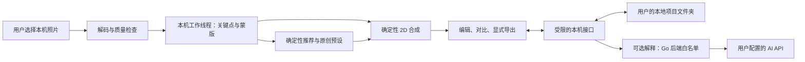

# 架构与决策

首版业务边界已确认：静态正面照、三套规则推荐、三类 2D 图层；3D 留到后续。妆容数据保存在用户选择的本机项目文件夹；可选 AI 解释是首版唯一由应用主动发起的外部调用。本文描述 MVP 架构，当前实现范围见[桌面启动说明](subsystems/desktop.md)。

## 候选执行架构

采用 Go 1.26 + Wails v3.1.0 + WebView2，前端以 TypeScript + Vite 起步。Go 负责原生文件选择、项目操作和 AI 请求；Wails 只绑定明确的业务操作；WebView2 只加载嵌入的界面和运行资源。Go 校验项目和入参，WebView2 限制导航、弹窗和外部资源，发布版不启用调试端口、不开放本机监听服务。模型与 WASM 优先走 Wails 内嵌资源服务，先验收 MIME、解码、Worker 和 WebGL。开发安装依赖可联网；发布应用不下载脚本、模型或字体。

候选项目格式为 `project.json`（格式版本、项目 ID 和草稿引用）、`photos/`（应用导入的照片）、`drafts/`（妆容草稿和偏好）。API 密钥保存在 Windows 凭据区。界面仅持有 Go 提供的资源 ID，不传可写路径；项目根由原生选择器授予。读写核对规范化路径，拒绝指向根外的符号链接、联接点及上级目录引用。元数据在同目录写临时文件再替换；同一项目只允许一个写入会话，预留崩溃恢复。删除只清理应用拥有的条目，不递归删除用户选择的根。关闭项目后重置界面与内存。用户应选择本机非同步目录；项目隔离依赖 Windows 账户和文件权限，不代表每个项目有独立系统账户或照片加密。

建议的公开操作按工作流命名：`createProject`、`openProject`、`importPhoto`、`saveDraft`、`deletePhoto`、`exportPreview` 和 `explainPreset`。初始化先验收应用窗口，暂不实现这些接口。业务迭代时再按纵向切片逐个确认接口和失败用例；不要暴露通用的文件系统、网络或任意命令调用。

## 模块职责

| 模块       | 输入与输出                                                | 边界                                                                                                                                                                                                                                      |
| ---------- | --------------------------------------------------------- | ----------------------------------------------------------------------------------------------------------------------------------------------------------------------------------------------------------------------------------------- |
| 工作台     | 本机文件、编辑操作 → 当前照片、草稿、预览                 | 新照片/清空使旧异步任务失效；导出由用户触发。                                                                                                                                                                                             |
| 面部分析   | 归一化图像 → 拒绝原因或关键点、质量与有限的几何描述       | 先试 [MediaPipe Face Landmarker](https://developers.google.com/edge/mediapipe/solutions/vision/face_landmarker?tab=Web)；关键点不是像素级分割。以唇缘减内唇、避开虹膜的上眼睑区域、脸颊软遮罩做第一版；人工标注证明质量不足才试语义分割。 |
| 推荐与资产 | 场景、偏好、本地几何或色调置信度 → 三套预设 ID 与本地说明 | 预设有 `schemaVersion`、稳定 ID 和有序图层。光线不可信时不强行估计肤色。                                                                                                                                                                  |
| 2D 渲染    | 同一张归一化原图、图层参数和受限蒙版 → 预览               | 每次从原图重算，不把上一次预览当作底图。优先验证 Canvas/像素合成；仅在性能证据支持时考虑 WebGL。外部 AI 不接触渲染参数。                                                                                                                  |
| 本地工作区 | 项目句柄、原图引用和草稿 → 保存、恢复、删除               | 管理版本、崩溃恢复与生命周期；关键点、蒙版和预览按需重建。                                                                                                                                                                                |
| AI 解释    | 限定场景、偏好、预设编号 → 纯文本解释或本地回退           | 与图像和推荐模块分开；没有照片、脸部信息或项目路径。                                                                                                                                                                                      |

妆容图层最小契约：`{ id, kind, colorSrgb, opacity, coverage, blend }`。`kind` 为口红、眼影或腮红，`opacity` 限 `[0, 1]`，`coverage` 的可调范围由各区域安全蒙版限制。MVP 将颜色定义为 `#RRGGBB` sRGB；统一 EXIF 方向和预览坐标，明确工作分辨率。若以后引入 UV 图层，复用妆容意图和编辑交互，在 3D 后端定义自己的材质表达；不要求 2D 蒙版直接兼容。

照片输入的格式、容量、尺寸、静态解码和原图预览契约见[本机照片校验](subsystems/photo-input.md)。选图和原图预览不依赖模型；用户主动分析面部时才加载经过校验的本机模型。[口红](subsystems/lipstick-preview.md)、[腮红](subsystems/blush-preview.md)和[眼影](subsystems/eyeshadow-preview.md)共用同一次分析，在工作原图上独立合成，试妆不保存项目数据。

## 选型与退出条件

| 决策                             | 理由与重新评估条件                                                                                                                                                                                                                                                                                                       |
| -------------------------------- | ------------------------------------------------------------------------------------------------------------------------------------------------------------------------------------------------------------------------------------------------------------------------------------------------------------------------ |
| Wails + WebView2 优先于 Electron | 保留原生目录选择和离线资源，去掉随应用分发的 Chromium 与 Node 运行时。代价是需要维护 Go/前端边界，并验证系统 WebView2 的版本、显卡和策略差异。详见[桌面技术决策](desktop-decision.md)。                                                                                                                                  |
| 确定性合成优先于生成式预览       | 便于验证图层影响和区域外像素不变。关键点失准、蒙版溢色和主观不自然仍需独立验收。                                                                                                                                                                                                                                         |
| 3D 后置                          | [makeup-extract](https://github.com/YangXingchao/makeup-extract) 和 [makeup-priors](https://github.com/YangXingchao/makeup-priors) 的原始说明要求 CUDA、Nvdiffrast、FLAME2020 等资产，适合独立离线对照试验。只比较使用许可已核实的代码、权重和纹理；[FLAME](https://flame.is.tue.mpg.de/) 的模型、数据和纹理有独立条款。 |
| 不把人脸识别模型作为运行依赖     | [InsightFace 模型库](https://github.com/deepinsight/insightface/tree/master/model_zoo) 对预训练权重单列研究用途限制；如后续做相似度研究，先校准指标并确认具体权重许可。                                                                                                                                                  |

模型登记字段：名称、用途、精确版本、下载出处、模型卡和适用许可链接、SHA-256、商用与再分发状态。[MediaPipe 仓库](https://github.com/google-ai-edge/mediapipe/blob/master/LICENSE)和[关键点模型卡](https://storage.googleapis.com/mediapipe-assets/Model%20Card%20MediaPipe%20Face%20Mesh%20V2.pdf)是独立证据；完整 `.task` 包中的几何元数据和 WASM 第三方归属仍待逐项核实。先完成小样本推理、离线装载和蒙版对照试验，再决定是否引入模型包。以 CPU 推理为初始候选，但 CPU 路径仍可能需要 WebGL 上下文；必须在目标 Windows 机器验证。[图像处理源码](https://github.com/google-ai-edge/mediapipe/blob/master/mediapipe/tasks/web/vision/core/vision_task_runner.ts)
